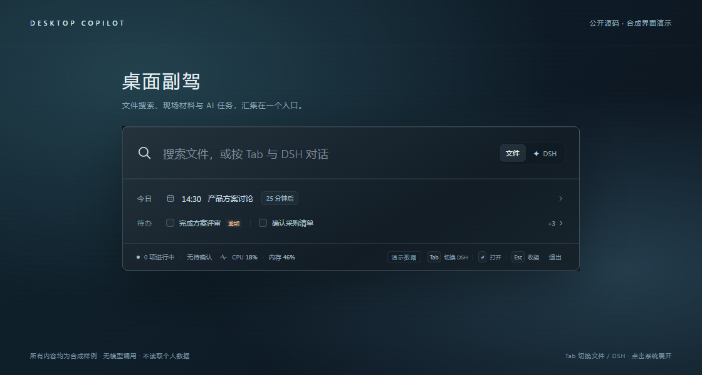
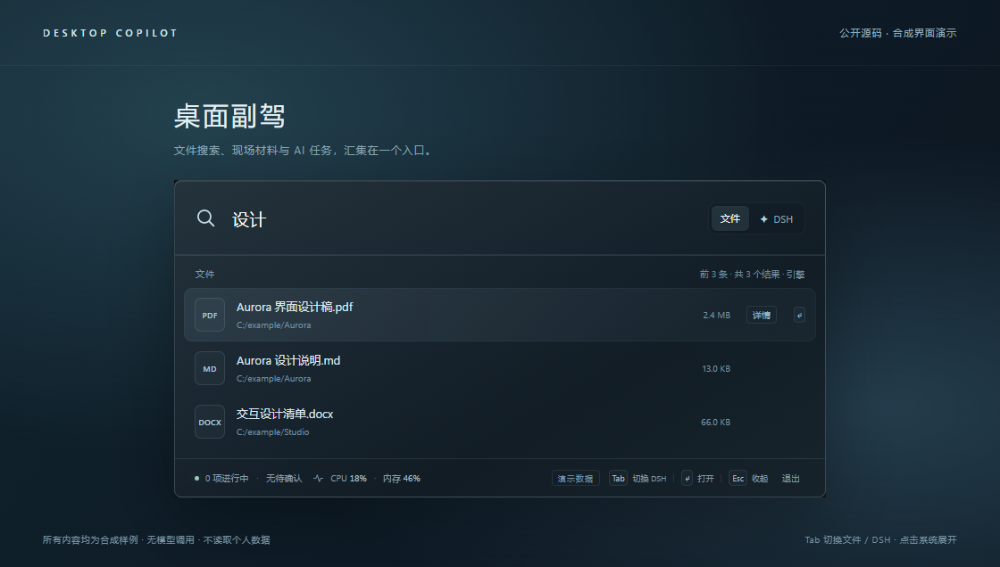
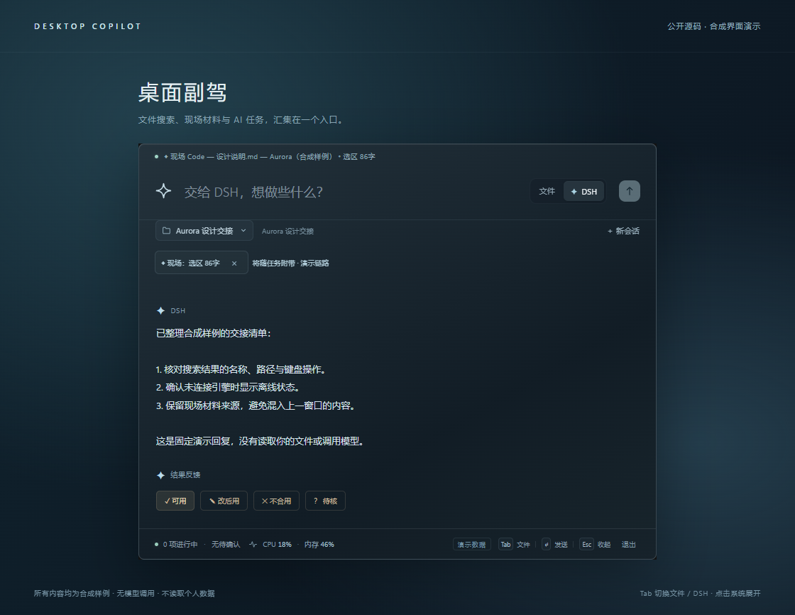
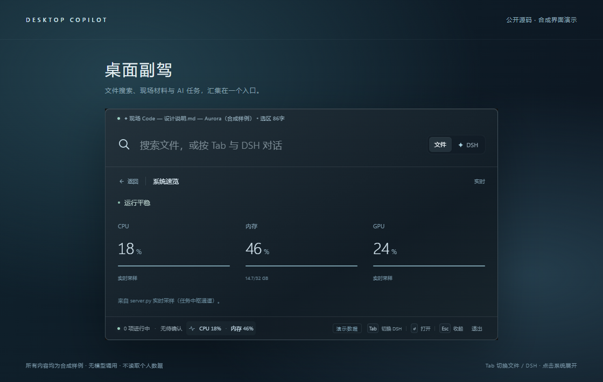
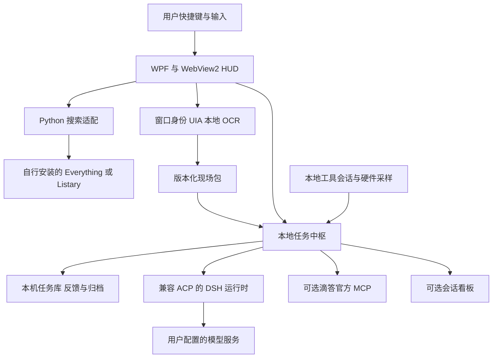

# 桌面副驾 Desktop Copilot

[](LICENSE)

面向 Windows 的本地 AI 工作台：用快捷键呼出一个半透明 HUD，在同一个入口搜索文件、查看 AI 任务、带上当前窗口的材料向副驾提问，并查看日程与系统负载。保留 AGENT DECK 会话看板和桌面图标编排，核心功能不依赖 Wallpaper Engine。

项目采用 Python 数据服务与 WPF + WebView2 原生窗口，支持接入本地搜索引擎、DSH 运行时和滴答清单。可以先通过浏览器演示体验界面，再按使用需求配置原生功能。

## 界面预览

以下截图展示 HUD 的紧凑入口、文件搜索、副驾对话和系统速览，使用演示数据。

**紧凑入口：文件搜索、今日安排与系统速览**



**文件搜索：结果、路径与键盘操作**



**桌面副驾：现场材料、对话与任务状态**



**系统速览：按需展开**



截图来源、复现方式与展示边界见 [界面截图说明](docs/screenshots.md)。

## 为什么做这个项目

同时使用多个 AI 工具时，任务分散在不同窗口里，查找文件、复制材料、切换工具和追踪进度会打断工作。桌面副驾把这些入口放到本机工作界面旁边：默认是搜索框，需要交给 AI 时切换到 DSH，对话展开后仍能看到本轮的材料和状态。

项目保留两种展示方式：`native_hud/` 是主要的快捷键入口；`deck/` 和 `wallpaper/` 是适合常驻观察的经典侧栏与全屏会话看板。二者使用同一套本地数据能力，网页看板嵌入桌面时才需要另行配置渲染宿主。

## 公开版提供什么

| 能力 | 实现与使用条件 |
| --- | --- |
| 半透明原生 HUD、快捷键、托盘、键盘交互 | WPF + WebView2；需要 Windows、.NET 8 SDK 和 WebView2 Runtime |
| 本地文件搜索、打开、定位 | Everything HTTP 服务或 Listary 本机接口；没连接时显示离线 |
| 多工具会话与用量展示 | Qoder、Hermes、ZCode、Kimi Code、Kimi Work、Codex、DSH 的本地记录适配；客户端版本变化可能影响解析 |
| DSH 副驾对话、工具进度、许可与取消 | 需要自行准备兼容 ACP 的 DSH 运行时及模型配置；默认关闭 |
| 当前窗口身份、UIA 材料和 OCR 兜底 | Windows 接口与可选本地 OCR；窗口类型、权限与材料覆盖会影响采集 |
| 现场版本、提交重试与会话连续性 | 提交身份与现场包冻结、旧观测丢弃、同代材料合并；有回归测试 |
| 结果反馈与本地归档 | 原始事件、展示快照与版本化修复视图分别保存；人审反馈不等于自动验收 |
| 今日待办、未来 24 小时日程、完成写回 | 需要滴答官方 MCP 口令；未配置或失败时标注演示/不可用 |
| 系统负载与历史曲线 | psutil 与可用的 GPU 探测；部分指标依赖硬件和驱动 |
| 桌面图标编排与快照恢复 | Windows Explorer 图标接口；改变坐标，不移动或删除磁盘文件 |
| 长期个人记忆、持续事项、独立浏览器扩展 | 后续方向，本次公开版不作为已经完成的能力 |

## 先运行无模型演示

只需要 Python 3.10+ 和浏览器，不安装第三方 Python 包，不启动真实数据服务，不读取会话、文档、剪贴板或系统指标。

```powershell
git clone https://github.com/Doubixilin/desktop-copilot-open-source.git
cd desktop-copilot-open-source
python demo/serve.py --port 18766
```

打开 `http://127.0.0.1:18766`。输入任意文件查询可查看合成结果，按 Tab 切换 DSH，点击“系统”展开指标。发送任务只返回固定演示回复；打开文件和写入日程均不会调用真实系统。Ctrl+C 停止演示服务。

演示直接加载 `native_hud/ui/` 页面，通过本地假桥接替代 Windows 宿主。服务仅提供演示所需的 HTML/CSS/JS，不暴露仓库、数据库或真实 `/copilot` 接口。演示可用于跨平台浏览界面，原生功能仍面向 Windows。

## 在 Windows 启动真实功能

需要 Python 3.10+、.NET 8 SDK、WebView2 Runtime；文件搜索需要另装 Everything 或 Listary。首次安装与构建会获取依赖。先阅读 [安装与配置](docs/setup.md) 和 [数据与安全边界](docs/privacy.md)。

```powershell
python -m venv .venv
.\.venv\Scripts\Activate.ps1
python -m pip install -r requirements.txt
python -m pip install -r requirements-copilot.txt
dotnet build native_hud/host -c Release
```

HUD 配套服务：

```powershell
$env:QD_PANEL = "0"
python server.py
```

另一个终端中启动原生 HUD：

```powershell
.\native_hud\host\bin\Release\net8.0-windows\NativeHud.exe
```

`Ctrl+Alt+K` 呼出或收起，Tab 在文件与 DSH 间切换，Esc 关闭当前详情或收起窗口。托盘菜单可以退出。默认未启用副驾时，页面会说明配置条件；完整接入步骤见 [DSH 配置](docs/setup.md#启用-dsh-副驾)。

`server.py` 的真实模式会读取支持工具的本地会话记录、采集进程使用情况，并启动桌面图标编排线程。演示模式与它完全分开；启动前确认你接受这些行为。不要用真实模式生成公开截图。

## 设计与代码阅读路线



| 想了解什么 | 文档 |
| --- | --- |
| 交互思路、工作流程与源码入口 | [设计与架构](docs/architecture.md) |
| 如何安装、配置搜索、DSH、日程和看板 | [安装与配置](docs/setup.md) |
| 哪些数据留本地、哪些会传给模型或第三方 | [数据与安全边界](docs/privacy.md) |
| 公开版排除了什么、如何继续安全更新 | [公开版本范围](docs/public-scope.md) |
| 本次验证了什么、还需要什么实机验证 | [验证记录](docs/validation.md) |
| 如何提交问题与贡献代码 | [贡献说明](CONTRIBUTING.md) |
| 依赖和第三方资源的许可 | [第三方说明](THIRD_PARTY_NOTICES.md) |

## 测试

```powershell
python -m pip install pytest
python -m pytest tests -q
node --test tests/test_native_hud_ui.mjs
```

部分 Windows 测试会创建临时测试窗口或探测 UIA/OCR，属于实机测试；不要把它们作为任意机器上无副作用的纯逻辑测试。自动化检查、浏览器截图与真实桌面验收的区别见 [验证记录](docs/validation.md)。

## 许可证

本仓库作者拥有权利的代码、文档和演示采用 [MIT](LICENSE)。第三方依赖、运行时、客户端和服务遵循各自条款。
