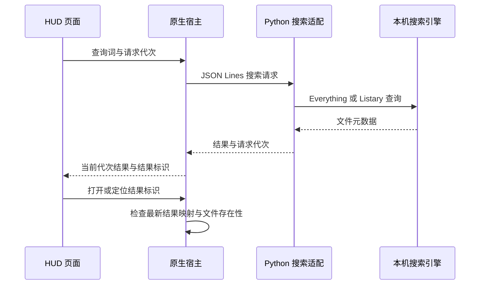
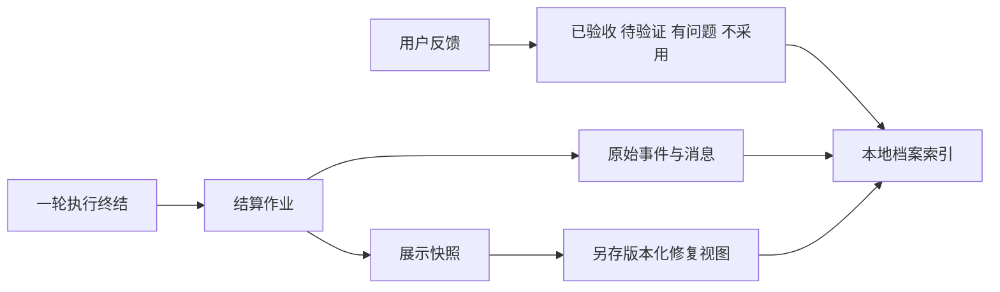

# 桌面副驾设计与架构

桌面副驾将文件搜索、当前工作材料和 AI 执行状态放在一个快捷键入口中。默认界面保持紧凑：查找文件时结果替换速览，切换到副驾时展开会话和材料条，需要更多信息时再展开任务、系统或日程详情。

## 两种界面共用本地能力

`native_hud/host/` 是 WPF 与 WebView2 原生宿主，负责快捷键、托盘、窗口材质、屏幕定位和子进程。`native_hud/ui/` 是本地 HTML/CSS/JavaScript 页面，只通过 WebMessage 与宿主交换规定的消息。宿主限定本地虚拟主机，阻止外站导航和新窗口；页面 CSP 的 `connect-src 'none'` 禁止直接发起网络请求。真实 HTTP 通信由宿主完成。

`deck/` 经典侧栏和 `wallpaper/` 全屏面板适合常驻查看多工具会话、任务详情和硬件曲线。网页显示本身不需要 Wallpaper Engine；需要铺在桌面背景时，才由用户选择渲染宿主。公开版没有把上游 Electron 桌面接管方案纳入本项目。

## 文件搜索链路

结果标识由宿主生成，页面不能把任意路径塞入“打开”动作。查询变化、切换模式或收起窗口时，旧动作映射失效；旧请求迟到时不会覆盖新结果。无搜索引擎时，界面显示离线，不以空结果冒充正常查询。

关键入口：`listary_engine.py`、`native_hud/search_adapter.py`、`native_hud/host/SearchClient.cs`、`HudWindow.cs`。

## 从窗口现场到一轮任务

现场采集分层进行：L0 获取前台窗口的进程、标题等身份；L1 按场景尝试标题解析、UI Automation、弹窗或终端材料；L2 在覆盖不足时使用本地截图 OCR。剪贴板信号仅采集格式元数据，按需读取文件列表，不读取剪贴板文本正文。

每次窗口观测带 `scene_id` 和 `generation`。新观测出现时清空旧材料；同一观测的 UIA、OCR 与剪贴板文件材料合并去重；上一窗口迟到的结果被丢弃。任务提交时冻结现场包，避免后续窗口变化改变已经提交的材料。材料覆盖状态仍需用户核对：一个选区或 OCR 结果不能代表完整文档。

HUD 中的材料条可在本轮提交前移除。路径引用可能让执行端读取文件，现场包可能包含窗口正文；两者都应按“即将交给你配置的执行端”的材料理解。

关键入口：`native_hud/scene_adapter.py`、`scene_probe.py`、`scene_capture.py`、`scene_fusion.py`、`copilot/scene_package.py`。

## 提交与会话连续性

`copilot/hud_api.py` 接收任务、会话、引用和现场包。客户端生成 `request_id`，服务以请求身份与内容指纹防止重复执行。发送结果未知时重试冻结的原始载荷；明确失败时保留草稿。新会话展示与提交采用一致身份，原会话消失后回到新会话入口。

`copilot/controller.py` 管理执行状态、事件与许可；`acp_adapter.py` 与用户配置的 DSH 运行时通信。运行时按需启动，受控退出时取消、关闭会话并回收归属子进程；收起 HUD 本身不会取消任务。当前 ACP 控制器同时只接受一个未终结轮次，不应理解为任意并行执行平台。

执行端自己的权限与沙箱决定实际文件操作范围。工作区内写操作可能直接执行，不能把 UI 的许可按钮理解为每次写入都需要再次确认。

## 结算、反馈与归档

结算由控制器终态通知与启动补偿驱动，HUD 关闭时仍可归档。原始记录保留，展示修复另存版本；用户反馈记录对产物的判断，不重写原事件，也不把模型“已回复”自动升级成验收通过。

关键入口：`copilot/store.py`、`archive.py`、`settlement.py`、`task_hub.py`、`mcp_server.py`。归档当前属于本地任务留存，不等同于已经实现长期个人记忆学习。

## 多工具采集与本地数据服务

`agent_sessions.py` 统一不同工具的本地会话结构，`usage.py` 和 `quota.py` 汇总用量与可获得的额度信息。记录缺失或解析失败时降级；各工具的状态与更新频率可能不同，时间窗内活跃不等于模型一直在运行。

`server.py` 提供 `/performance`、`/deck`、`/usage` 和带本机令牌的 `/copilot/hud*` 接口。常驻线程包括采样、使用日志、桌面编排和任务结算。`zones_*` 按规则计算并应用桌面图标坐标；`desktop_layout.py` 保存与恢复快照，不移动磁盘文件。

## 当前产品边界

浏览器预览使用实际页面与假宿主，只能验证 UI 与合成数据交互。原生窗口需要 Windows 实机验证。搜索依赖第三方索引，副驾依赖另行准备的运行时与模型，滴答功能依赖账户口令与外部服务。

长期记忆、持续事项、项目注册、独立浏览器扩展、主动通知和深层应用适配是后续方向。公开版未把规划文档中的目标当作现成功能。
